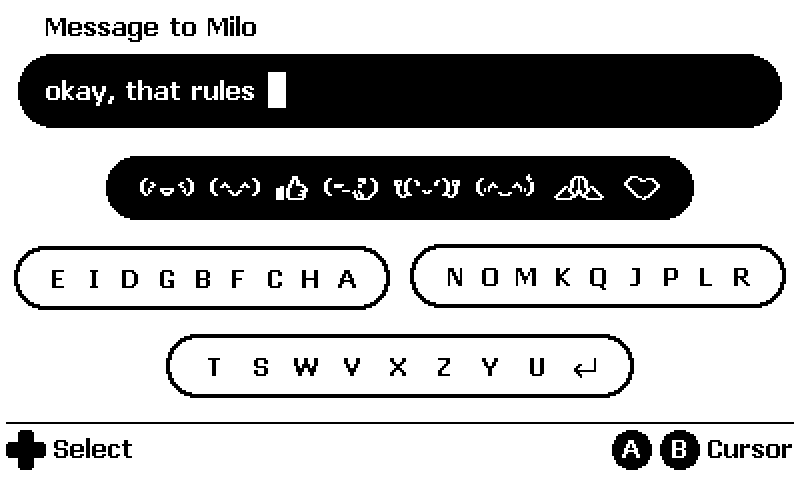

# Playdate Touchtyping Keyboard

**Hold a direction. Pick a character. Release to write.**

Type messages, notes and names with the controls already under your thumbs.
Touchtyping turns Playdate's D-pad, buttons and crank into a keyboard you can
learn by feel.



## How it works

Each D-pad direction opens a group of characters. Keep it held and use **A** to
select forward, **B** to select backward, or turn the **crank**. Release the
direction to insert the character. Then choose the next one.

Common letters sit near the ends of their groups, within easy reach of either
button. The groups stay in place, so the movements become familiar. Use both
thumbs, or let the crank do the selecting.

With the groups closed, tap A to shift or B to delete. Hold A to move the cursor
or switch views. Unicode text, 21 pixel emoji and cursor editing are included.

> “Wish your keyboard was used in other apps like ToDo lists etc”
>
> — [Dangerous_Ad5614, r/PlaydateConsole](https://www.reddit.com/r/PlaydateConsole/comments/1xhutcf/comment/19rtkjog2829v/)

[itch.io feedback](https://itch.io/post/17746366) · [Reddit discussion](https://www.reddit.com/r/PlaydateConsole/comments/1xhutcf/i_made_brb_a_real_online_chat_messenger_for_your/)

## 62% fewer button presses

Tap-only comparison: the same 12 English/German phrases, 177 characters.

| Keyboard | Button presses | Touchtyping saves |
| --- | ---: | ---: |
| **Touchtyping** | **480** | — |
| Playdate's built-in keyboard (SDK 3.1.2) | 1,270 | **62.2%** |
| ABC grid from bill's 1.0.1 | 788 | **39.1%** |

Button presses counted; typing time not measured.
[Method, full results and runnable benchmark →](docs/benchmarks/README.md)

## Put it in your app

The library is **C**, uses the **[Playdate SDK](https://play.date/dev/)**, and runs
entirely on the device.

1. Copy `src/`, `Source/keyboard/` and the [license notices](THIRD_PARTY.md) into
   your project.
2. Add the [seven C files](docs/integration.md#copy-the-dependencies) to your
   build and link `-lm`.
3. Initialize once, open it when you need text, and pass it your frame's input:

```c
static HelloKeyboard keyboard;

// Once at startup.
HelloKeyboardConfig config;
hello_keyboard_default_config(&config);
hello_keyboard_init_with_config(&keyboard, pd, &config);

// Open an editor.
hello_keyboard_open_configured(&keyboard, "Hello Playdate!", NULL);

// In your update loop while the keyboard is visible.
HelloKeyboardResult result = hello_keyboard_update(
    &keyboard, now, buttons, pressed, released, crank_delta);
hello_keyboard_draw(&keyboard, now);
```

On `HELLO_KEYBOARD_DONE`, copy `hello_keyboard_text(&keyboard)` and close the
editor with `hello_keyboard_close`. Your app decides where the text goes.

Use the [complete C example](examples/keyboard_minimal.c) as a starting point.
Set `PLAYDATE_SDK_PATH`, then run `make all` to build it locally. To add the wider
Unicode font, include `Source/unicode/glyphs.bin` and follow the
[integration guide](docs/integration.md). It also covers custom groups, emoji
sets, field limits, labels and timing.

## In my apps

- **[brb - chat messenger](https://geekhunger.itch.io/brb-chat-messenger)** — Online
  chat on Playdate. Type messages, set your name and add your friends.
- **[bill’s](https://geekhunger.itch.io/bills)** — Project timers and session notes,
  using the earlier Lua keyboard.

## Source & license

Code and original artwork: **[MIT](LICENSE)**. Fonts and Unicode data retain
their [own licenses](THIRD_PARTY.md).

The C library lives in `src/`. The earlier Lua version is preserved in
[`legacy/lua/`](legacy/lua/). Run `make test`, `make test-sanitize` and
`make check-stack` for the native checks.

Made by [Geekhunger](https://geekhunger.com).
