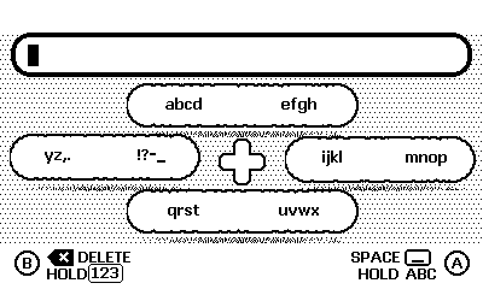
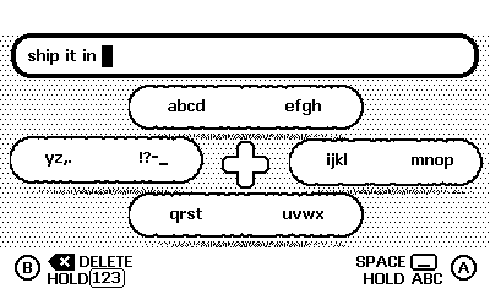

# Cloud Keyboard

### small clouds. big words.

A floating, one-bit keyboard for **Playdate**. Pick a cloud with the D-pad,
cycle letters with A/B, or give the crank a spin. Little cloud tiles, soft
pixel shadows and just enough motion to make entering a note feel good.



**Drop it into your game. Get text back.** Cloud Keyboard handles the draft,
cursor, input focus and System Menu. Your app decides what to do with the result.

[Get started](#drop-it-in) · [Controls](#controls) · [API and integration guide](docs/integration.md) · [Download the demo](https://github.com/geekhunger/playdate-cloud-keyboard/releases/latest)

## A little crank goes a long way

The crank moves through the entire selected group in both directions. A or B
held on a selected letter gives you its opposite case for that one character.
The rest of your sentence keeps its case.


## Made for small screens and real buttons

- Four letter groups, each split between B and A.
- Selected letters stay inside their cloud. The matching side button lights up.
- Floating clouds lift away from their soft, dithered shadows.
- A second layer brings numbers and cursor controls.
- Clear, Done and Cancel live in the System Menu.
- Native 400 × 240 graphics. No runtime dependencies beyond the Playdate SDK.



## Drop it in

Copy **`Source/keyboard.lua`** and **`Source/keyboard/`** into your project's
`Source/`. Keep the paths intact, including the bitmap assets.

```lua
import 'keyboard'

local text = ''
local keyboard = Keyboard.new({
    maxLength = 64, -- optional
    onDone = function(value) text = value end,
    onCancel = function() end,
})

function openInput()
    local ok, err = keyboard:show(text)
    assert(ok, err)
end

function playdate.update()
    if keyboard:isVisible() then
        keyboard:update()
        keyboard:draw()
        return
    end
    -- Your app's update and drawing.
end
```

The host keeps its update loop and owns persistence. While the keyboard is open,
pause your own button polling. It uses Playdate's modal input-handler stack and
needs all **three custom System Menu slots** for Clear, Done and Cancel.
See the [integration guide](docs/integration.md) for the full API and lifecycle.

## Controls

| State | Input | Action |
| --- | --- | --- |
| Letter layer | D-pad ↑ / → / ↓ / ← | `abcd efgh` / `ijkl mnop` / `qrst uvwx` / `yz,. !?-_` |
| Group selected | B / A tap | Cycle the left / right half |
| Group selected | Crank | Cycle the entire group in either direction |
| Letter preview selected | A or B hold | Commit this character in the opposite case |
| Group selected | Wait 750 ms | Accept the preview, or reset an empty group |
| No group | A tap / B tap | Space / Delete |
| No group | A hold | Toggle upper/lower case |
| No group | First B press held | Switch letter/number layers |
| No group | B tap, release, then B press-and-hold | Repeated Delete until release |
| Number layer | D-pad ↑ | `12345 67890` |
| Number layer | D-pad ← / → | Move cursor; hold to repeat |
| System Menu | Clear / Done / Cancel | Empty draft / return text / discard draft |

Holds trigger after 350 ms. The second B press must start within 500 ms of the
first tap's release. Cursor repeat starts after 250 ms. Repeat stops on release.

The current keyboard is **single-line, printable ASCII**. It does not yet offer
umlauts or other Unicode input. `show()` rejects unsupported initial text rather
than changing it silently.

## Build the demo

Install the [Playdate SDK](https://play.date/dev/), then:

```sh
export PLAYDATE_SDK_PATH=/path/to/PlaydateSDK
make build
make test # focused input/controller checks
```

Open `build/CloudKeyboard.pdx` in the Simulator, or sideload it onto a Playdate.
The source was built with SDK 3.1.2 and the input has been checked on real hardware.

To regenerate the artwork, install Pillow and run `make artwork`. To regenerate
the README animations from the actual SDK renderer:

```sh
python3 tools/record_demo.py
```

On macOS the recording script finds the Simulator inside `PLAYDATE_SDK_PATH`.
On other platforms set `PLAYDATE_SIMULATOR` to its executable path. The GIFs use
nearest-neighbor scaling and two colors; no smoothed mockup frames are mixed in.

## License and credits

Code and original UI artwork: [MIT](LICENSE). The Oklahoma Bold bitmap font is
from Panic's Playdate SDK and retains its [CC BY 4.0 terms](THIRD_PARTY.md).

Made by [Geekhunger](https://geekhunger.com).
